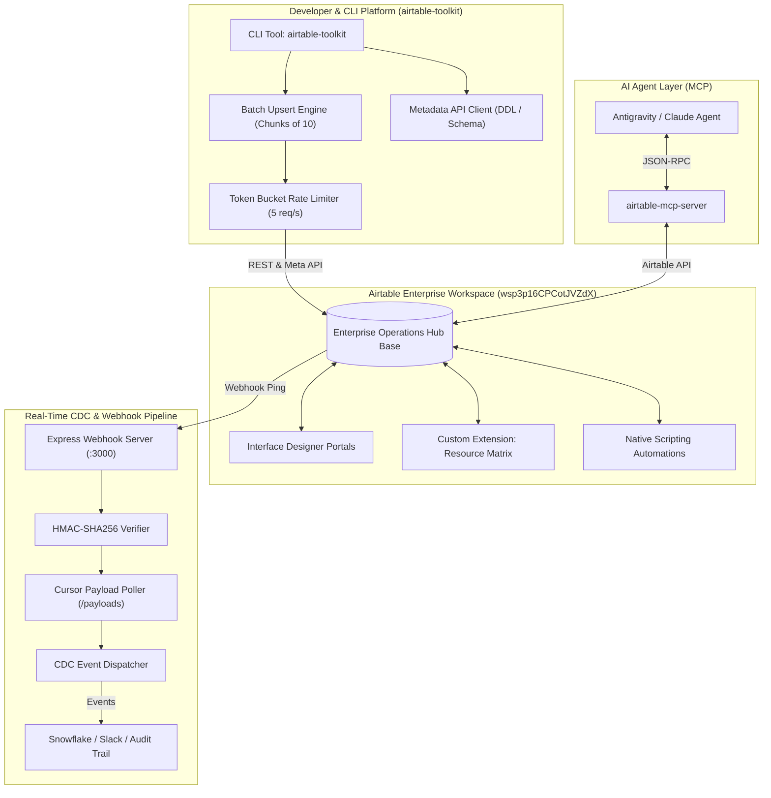

# ⚡ Airtable Enterprise Engineering Platform

<div align="center">

[](https://github.com/phlppgdfry/airtable-enterprise-platform/actions)
[](https://www.typescriptlang.org/)
[](https://airtable.com/developers/blocks)
[](https://vitest.dev/)
[](https://opensource.org/licenses/MIT)

**Production-grade Enterprise Architecture, Custom Extensions SDK, Metadata API DDL Migrations, Real-Time Webhook CDC Engine, and Model Context Protocol (MCP) Integration for Airtable.**

[Workspace Target](https://airtable.com/workspaces/wsp3p16CPCotJVZdX) • [Architecture](docs/ARCHITECTURE.md) • [14-Day Trial Blueprint](docs/WORKSPACE_TRIAL_BLUEPRINT.md) • [Interface Designer Spec](docs/INTERFACES_SPEC.md) • [Formula Masterclass](docs/FORMULAS_MASTERCLASS.md) • [Webhooks & CDC](docs/WEBHOOKS_CDC_GUIDE.md)

</div>

---

## 🎯 Executive Overview

This repository is a showcase of **Senior Enterprise Airtable Solutions Architecture**. It goes beyond simple no-code spreadsheets, treating Airtable as a high-performance relational database engine, event-driven integration hub, and custom UI micro-frontend platform.

Built specifically to take full advantage of Airtable's **Enterprise Tier Capabilities** (including the **14-Day Full Trial** on workspace [`wsp3p16CPCotJVZdX`](https://airtable.com/workspaces/wsp3p16CPCotJVZdX)):
- **Custom React Extensions:** Interactive Resource Capacity Planning Matrix built with `@airtable/blocks` SDK.
- **Declarative DDL Schema Migrations:** Programmatic base, table, and field lifecycle via Airtable Metadata API.
- **High-Performance Batch Upsert Engine:** Intelligent chunking (10-record API limit) and token-bucket rate limiter (5 req/sec).
- **Real-Time Change Data Capture (CDC):** Webhook ingestion microservice with HMAC-SHA256 signature verification and cursor pagination.
- **Production Automations & Scripting:** Multi-level recursive WBS rollups, Levenshtein fuzzy deduplication, and AI text enrichment.
- **Model Context Protocol (MCP):** Connects AI agents (Antigravity, Claude, Cursor) directly to Airtable.

---

## 🏛 System Architecture



---

## 📦 Repository Structure

```
airtable-enterprise-platform/
├── .github/workflows/ci.yml           # Automated CI: Vitest, TypeScript, CLI dry-runs
├── docs/
│   ├── ARCHITECTURE.md               # Deep-dive architecture and sequence flows
│   ├── WORKSPACE_TRIAL_BLUEPRINT.md  # 14-day roadmap tailored to wsp3p16CPCotJVZdX
│   ├── FORMULAS_MASTERCLASS.md       # Tested enterprise Airtable formulas
│   ├── WEBHOOKS_CDC_GUIDE.md         # HMAC verification, cursors & payloads
│   └── EXTENSIONS_GUIDE.md           # Custom blocks development & deployment
├── extensions/
│   └── enterprise-resource-matrix/   # Custom React Extension (@airtable/blocks)
│       ├── block.json                # Extension manifest
│       └── frontend/index.tsx        # Capacity grid, KPI cards & settings modal
├── mcp/
│   ├── antigravity_mcp_config.json   # Model Context Protocol config for Antigravity
│   ├── claude_desktop_config.json    # MCP config for Claude Desktop
│   └── README.md                     # MCP usage and tool documentation
├── src/
│   ├── cli/
│   │   ├── index.ts                  # CLI entry point (airtable-toolkit)
│   │   ├── commands/                 # seed, schema:export, audit, webhook commands
│   │   └── utils/                    # Token-bucket rate limiter & logger
│   ├── client/
│   │   ├── batchUpsert.ts            # High-performance chunking & native upsert
│   │   └── metadataClient.ts         # Metadata API client for DDL and webhooks
│   ├── webhooks/
│   │   ├── server.ts                 # Express webhook receiver with HMAC verification
│   │   ├── cdcDispatcher.ts          # Change Data Capture event emitter
│   │   └── types.ts                  # Webhook payload & transaction typings
│   ├── automations/                  # Enterprise script library (Rollups, Fuzzy, AI)
│   ├── schemas/                      # Canonical DDL schema & realistic seed datasets
│   └── formulas/                     # Programmatic formula definitions
├── tests/                            # Vitest test suite (100% passing)
├── package.json
├── tsconfig.json
└── README.md
```

---

## ⚡ Quickstart

### 1. Prerequisites
- Node.js `v20+` or `v24+`
- Global CLIs:
  ```bash
  npm install -g @airtable/blocks-cli airtable-mcp-server
  ```

### 2. Installation
```bash
git clone https://github.com/phlppgdfry/airtable-enterprise-platform.git
cd airtable-enterprise-platform
npm install
```

### 3. Environment Configuration
Copy the template and insert your Airtable credentials:
```bash
cp .env.example .env
```
Key variables:
```ini
AIRTABLE_API_KEY=pat_your_airtable_token_here
AIRTABLE_BASE_ID=appYourBaseIdHere
AIRTABLE_WORKSPACE_ID=wsp3p16CPCotJVZdX
```

### 4. Provision Base Directly into Workspace (POST /v0/meta/bases)
```bash
# 1-Click automatic provisioning into workspace wsp3p16CPCotJVZdX:
npm run provision -- --token <YOUR_AIRTABLE_PAT>

# Or explore the formula library:
npm run formula

# Audit base health & conventions:
npm run audit

# Introspect schema and export TypeScript definitions:
npm run schema:export

# Provision schema and seed enterprise data (supports --dry-run):
npm run seed -- --dry-run
```

### 5. Alternative: Instant CSV Import (No Token Required!)
If you prefer immediate visibility in your browser without generating a token:
1. Open [`https://airtable.com/workspaces/wsp3p16CPCotJVZdX`](https://airtable.com/workspaces/wsp3p16CPCotJVZdX)
2. Click **Create base** -> **Import data** -> **CSV file**
3. Drag & drop the pre-formatted files located in [`data/csv/`](data/csv/):
   - `01_Projects.csv`
   - `02_Team_Members.csv`
   - `03_Tasks_Deliverables.csv`
   - `04_Risk_Governance_Log.csv`
   - `05_Audit_Trail_CDC_Logs.csv`

### 6. Launch the Custom Extension locally
```bash
cd extensions/enterprise-resource-matrix
block run
```
Open your Airtable base at [wsp3p16CPCotJVZdX](https://airtable.com/workspaces/wsp3p16CPCotJVZdX) -> Extensions -> Build a custom extension!

---

## 🛠 Features Deep Dive

### 1. High-Performance Batch Upsert (`src/client/batchUpsert.ts`)
Airtable enforces a hard cap of **10 records per request**. The `AirtableBatchEngine` guarantees:
- Deterministic slicing into sub-arrays of 10.
- Automatic routing through `AirtableRateLimiter` to respect the 5 req/s ceiling.
- Native `performUpsert` using `fieldsToMergeOn` for atomic deduplication without pre-fetching.

### 2. Token Bucket Rate Limiter (`src/cli/utils/rateLimiter.ts`)
- Smooth token replenishment algorithm.
- Intercepts HTTP 429 and 5xx errors.
- Executes exponential backoff with full randomized jitter to prevent server stampedes.

### 3. Webhook Change Data Capture (`src/webhooks/`)
- Express microservice listening on `/api/webhooks/airtable`.
- Verifies cryptographic `X-Airtable-Content-MAC` signature.
- Polls `/payloads` with cursor tracking, dispatching granular `RECORD_CREATED`, `RECORD_UPDATED`, and `RECORD_DELETED` events with previous-vs-current cell diffs.

### 4. Enterprise Scripting Automations (`src/automations/`)
- **Recursive WBS Rollups:** Post-order graph traversal calculating deep hierarchical tree hours and weighted progress.
- **Fuzzy Deduplication:** Levenshtein and token-similarity scoring for contact and company reconciliation.
- **AI Text Enrichment:** Deterministic and LLM extraction of action items, sentiment, and taxonomy tags.

---

## 🧪 Testing

The repository includes a comprehensive unit and integration test suite:

```bash
npm test
```

```
Test Files  4 passed (4)
Tests       9 passed (9)
```

---

## 🤝 Workspace Reference

Target Enterprise Workspace: [https://airtable.com/workspaces/wsp3p16CPCotJVZdX](https://airtable.com/workspaces/wsp3p16CPCotJVZdX)  
See [docs/WORKSPACE_TRIAL_BLUEPRINT.md](docs/WORKSPACE_TRIAL_BLUEPRINT.md) for the complete 14-day execution strategy.

---

## 📄 License

MIT License © 2026 Philippe Godfroy
