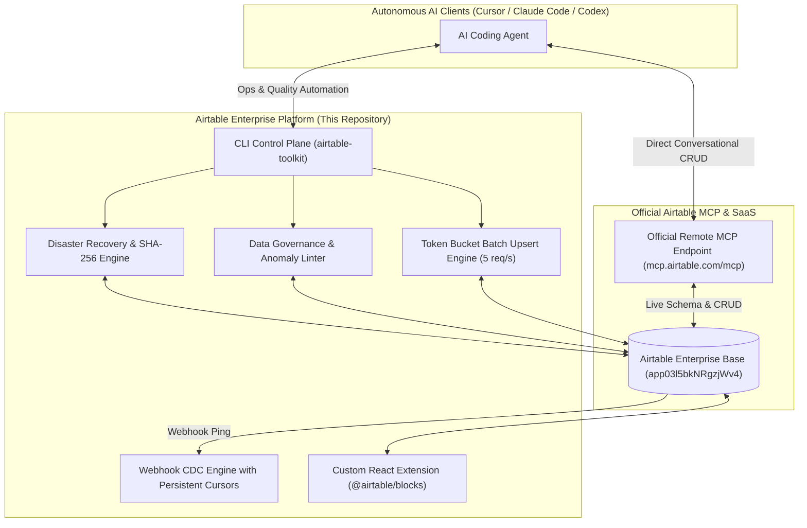

# Airtable Official MCP CLI vs. Airtable Enterprise Platform

## 1. Executive Summary

Airtable maintains an official Model Context Protocol (MCP) ecosystem consisting of:
- **Official MCP CLI:** [`Airtable/airtable-mcp-cli`](https://github.com/Airtable/airtable-mcp-cli)
- **Hosted MCP Endpoint:** `https://mcp.airtable.com/mcp`
- **Official Agent Skills:** [`Airtable/skills`](https://github.com/Airtable/skills)

This document provides an objective architectural evaluation comparing **Airtable's Official MCP infrastructure** with this repository (**`airtable-enterprise-platform`**).

Rather than reinventing or competing with official CRUD primitives, `airtable-enterprise-platform` is engineered as a **specialized Enterprise Data Operations, Governance, and Disaster Recovery platform** that complements and hardens agentic workflows.

---

## 2. Architectural Comparison Matrix

| Capability | Airtable Official MCP CLI (`airtable-mcp-cli`) | Airtable Enterprise Platform (`airtable-toolkit`) | Complementary Relationship |
|:---|:---:|:---:|:---|
| **Primary Focus** | Ad-hoc Agent CRUD Tooling & Dynamic Discovery | Enterprise Data Operations, CDC, Governance & DR | **Coexists:** Official MCP handles conversational CRUD; Enterprise Platform provides infrastructure & safety guards. |
| **Server Architecture** | Hosted Remote Endpoint (`mcp.airtable.com/mcp`) | Local CLI Tooling & Self-Hosted Webhook Microservice | **Complementary:** Zero-setup agent querying via official endpoint; enterprise event streaming via platform webhook daemon. |
| **Command Discovery** | Dynamic reflection of available tools via MCP JSON-RPC | Deterministic Command Palette (`airtable-toolkit`) | **Different scopes:** MCP tools are generic (`list_records`); toolkit commands are domain-specific (`migrate:plan`, `data:lint`). |
| **Disaster Recovery** | ❌ None (No snapshotting or restore capabilities) | ✅ **Production DR Engine:** SHA-256 verified JSON/NDJSON snapshots & natural-key upsert restore | **Critical Gap Filled:** Protects bases against accidental deletions by autonomous AI agents. |
| **Real-Time CDC (Webhooks)** | ❌ None (Pull-based conversational queries only) | ✅ **Event-Driven Push:** HMAC-SHA256 receiver, persistent cursors, and CDC dispatcher | **Critical Gap Filled:** Real-time event streaming to enterprise data warehouses (Snowflake, BigQuery). |
| **Data Quality & Governance** | ❌ None (Accepts any schema-compliant payload) | ✅ **Enterprise Linter:** Anomaly detection, date inversion, unmitigated risk detection (Scorecard A+ to F) | **Safety Layer:** Enforces corporate data hygiene before or after AI mutations. |
| **Rate-Limit & Batch Safety** | ⚠️ Dependent on client-side LLM tool loop | ✅ **Native Token-Bucket Limiter (5 req/s) & Max-10 Chunking** | **Infrastructure Guard:** Prevents HTTP 429 lockouts during high-volume agent data operations. |
| **Custom UI Micro-Frontends** | ❌ None (Headless terminal & text output) | ✅ **Custom React Extension (`@airtable/blocks`)** | **User Experience:** Renders visual resource capacity matrix inside Airtable Interface Designer. |
| **Declarative Migrations** | ❌ None (Direct imperative field mutations) | ✅ **Metadata API DDL:** Schema diffing between code definition and live base | **DevOps Layer:** Safe Git-versioned database migrations. |

---

## 3. Deep-Dive: How Official MCP Works

Airtable’s official remote Model Context Protocol server operates over Server-Sent Events (SSE) and HTTP POST:
- **Endpoint:** `https://mcp.airtable.com/mcp`
- **Authentication:** OAuth 2.0 (recommended for multi-user clients) or Personal Access Token (PAT).
- **Tool Protocol:** When connected to an agent (such as Claude Code, Cursor, or ChatGPT), the server dynamically declares tools such as `describe_tables`, `list_records`, `create_records`, and `update_records`.
- **Dynamic Reflection:** When Airtable adds a new capability to their MCP server, `airtable-mcp-cli` discovers it automatically without client recompilation.

---

## 4. Why Enterprise Tooling is Required Alongside Official MCP

While official MCP provides standard record-level read/write operations for LLMs, enterprise production deployments encounter distinct operational challenges that generic MCP tools do not solve:

### 4.1 The "Agent Blast Radius" Problem (Disaster Recovery)
When an autonomous AI agent with write permissions executes updates via official MCP, it can corrupt linked relationships, overwrite critical fields, or delete rows in seconds.
- **Solution provided by `airtable-enterprise-platform`:** Versioned point-in-time snapshots with cryptographic SHA-256 manifests (`npm run backup`) and dry-run validated natural-key restoration (`npm run restore --dry-run`).

### 4.2 The Rate-Limit / Quota Collapse
Airtable enforces a strict 5 requests per second rate limit per base and a maximum of 10 records per write call. If an agent attempts to ingest 500 records via sequential or un-throttled calls, Airtable returns `HTTP 429` and locks the base for 30 seconds.
- **Solution provided by `airtable-enterprise-platform`:** The `AirtableBatchEngine` automatically slices records into batches of 10 and routes all network calls through a leaky-bucket token rate limiter with randomized exponential backoff.

### 4.3 Change Data Capture (Push vs. Pull)
Official MCP is pull-based: an agent must wake up, issue a query, and inspect changes. It cannot trigger downstream events when an external user updates an Airtable cell.
- **Solution provided by `airtable-enterprise-platform`:** A hardened Express microservice listening for Airtable webhook pings, verifying constant-time HMAC-SHA256 signatures, persisting cursors across process restarts, and emitting granular `RECORD_CREATED`, `RECORD_UPDATED`, and `RECORD_DELETED` events.

### 4.4 Data Governance & Hygiene Grading
LLMs frequently introduce formatting inconsistencies, inverted date logic (e.g. Start Date after Target Date), or orphaned assignees.
- **Solution provided by `airtable-enterprise-platform`:** `EnterpriseDataLinter` automatically scans all entities, enforcing 7 enterprise validation rules and outputting an executive Grade A+ to F scorecard.

---

## 5. Recommended Architecture: Combined Hybrid Deployment

### Conclusion
By pairing Airtable's official MCP server for conversational CRUD with `airtable-enterprise-platform` for disaster recovery, CDC streaming, data quality auditing, and rate-limited batch transactions, enterprise organizations achieve both AI agent agility and operational reliability.
