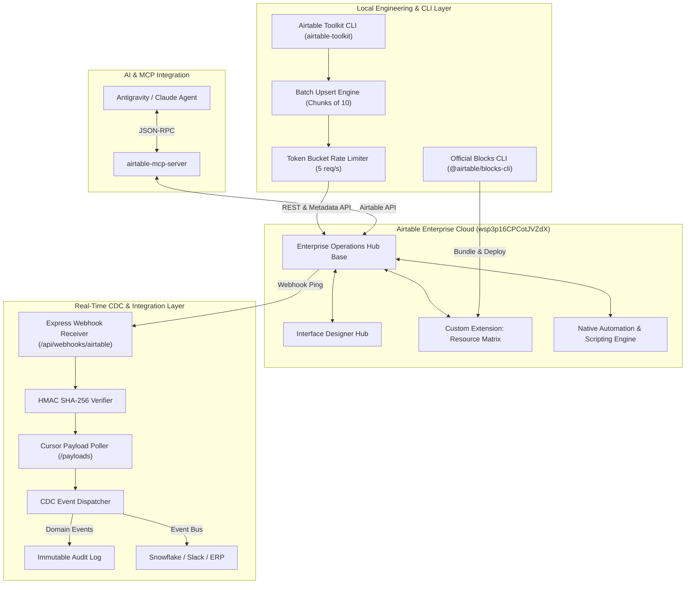

# 🏛 Airtable Enterprise Architecture Blueprint

This document illustrates the end-to-end architecture of this repository, showing how Airtable connects to modern enterprise stacks.

---

## High-Level System Architecture

---

## Key Enterprise Architectural Patterns

### 1. Token Bucket & Jittered Exponential Backoff
- **Problem:** Airtable's 5 requests per second rate limit triggers a 30-second ban on HTTP 429.
- **Solution:** `AirtableRateLimiter` enforces client-side request pacing using an in-memory token bucket. When encountering upstream network errors or 429s, it calculates exponential backoff with full jitter to avoid the thundering herd problem.

### 2. Batch Chunking & Native Upsert (`fieldsToMergeOn`)
- **Problem:** Airtable record mutations are limited to 10 records per network payload.
- **Solution:** `AirtableBatchEngine` automatically splits arrays of arbitrary length into slices of 10, executing them through the rate-limited pipeline. It natively uses `fieldsToMergeOn` for atomic upserting.

### 3. Asynchronous Webhook Polling with Cursor State
- **Problem:** Webhook pings from Airtable do not contain raw record data (for payload size reasons). They only contain `{ base, webhook, timestamp }` and require acknowledgement within 5 seconds.
- **Solution:** `server.ts` immediately responds with HTTP 200, then triggers background cursor polling against `/v0/bases/{baseId}/webhooks/{webhookId}/payloads?cursor={c}` to ingest full change transaction logs with cell-level diffs (`current` vs `previous`).
