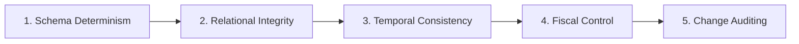

# 🛡 Enterprise Data Governance & Anomaly Detection Policy

This document defines the formal data governance and quality assurance standards enforced across Airtable bases using `airtable-toolkit data:lint`.

---

## 🏛 The 5 Pillars of Airtable Enterprise Governance



---

## Rule Registry & Quality Gates

| Rule ID | Severity | Scope | Description & Remediation |
| :--- | :--- | :--- | :--- |
| `PRJ_MISSING_PRIMARY` | **CRITICAL** | `Projects` | Every project record must possess a non-null, unique Project Code (`PRJ-YYYY-XX`) and Title. Unnamed records degrade interface UX and break foreign-key joins. |
| `PRJ_DATE_INVERSION` | **CRITICAL** | `Projects` | Temporal check ensuring `Start Date <= Target Go-Live`. Inverted dates break Gantt charts and timeline dependencies. |
| `PRJ_BUDGET_OVERRUN` | **WARNING** | `Projects` | Flags initiatives where `Budget Spent (€) > Budget Allocated (€) * 1.2`. Triggers automated PMO approval alert. |
| `TEAM_INVALID_EMAIL` | **CRITICAL** | `Team Members` | Validates corporate SSO email format (`user@domain.com`). Prevents unlinked notifications and permission gaps. |
| `TEAM_CAPACITY_OUTLIER` | **WARNING** | `Team Members` | Flags weekly capacities `< 1h` or `> 60h`. Prevents corrupted denominator values in utilization calculations. |
| `TASK_ORPHANED_PROJECT` | **WARNING** | `Tasks` | Disallows unlinked tasks in active sprint stages (`In Progress`, `Review`). |
| `TASK_UNASSIGNED_IN_FLIGHT` | **WARNING** | `Tasks` | Critical or in-progress work packages must have at least one assigned engineer. |
| `RISK_UNMITIGATED_CRITICAL` | **CRITICAL** | `Risk Log` | Forbids `Critical` or `Major` risk entries without actionable mitigation strategies (> 10 characters). |

---

## Automated CI/CD Quality Gate

Data governance checks are executed via:
```bash
npm run data:lint
```

The linter produces an **Executive Scorecard** grading the base from **A+ (100-95)** to **F (<50)**. In CI/CD pipelines, any `CRITICAL` violation exits with code 1 to block breaking releases.
