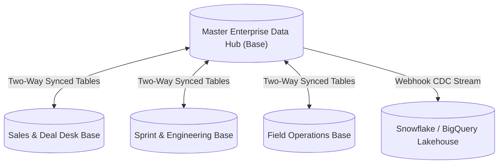

# ⚡ Airtable 50,000+ Record Scalability & Performance Tuning Guide

On **Enterprise Plans** (including the 14-day trial on workspace [`wsp3p16CPCotJVZdX`](https://airtable.com/workspaces/wsp3p16CPCotJVZdX)), Airtable scales from 1,000 records to **50,000 - 500,000 records per base**. Operating at this scale requires deliberate architectural choices to prevent formula re-calculation bottlenecks and API latency.

---

## 1. The Hub & Spoke Base Topology

Rather than creating a monolithic 500,000-record base that houses every department's operational details, modern enterprise architecture utilizes **Airtable Two-Way Sync**:

### Benefits:
- **Blast Radius Isolation:** Departmental formula edits or automation loops cannot freeze other teams.
- **Permission Boundaries:** Granular column and view-level access controls.
- **Sub-Second Grid Render:** Each spoke base stays snappy (< 10,000 records).

---

## 2. Preventing Formula Recalculation Cascades
In Airtable, modifying a single cell in a table with 50,000 records can trigger recalculation of all dependent rollup and formula fields:
1. **Avoid Dynamic Time Formulas in Large Tables:**
   - Formulas using `TODAY()` or `NOW()` invalidate cache globally every hour.
   - *Enterprise Best Practice:* Instead of `IF(TODAY() > {Due Date}, ...)`, run a daily scheduled Automation that stamps a static boolean field `Is Overdue = true`.
2. **Flatten Deep Rollup Chains:**
   - A rollup that rolls up another rollup across 4 linked tables creates an $O(N^2)$ dependency graph.
   - *Enterprise Best Practice:* Use `recursive-rollup-hierarchy.ts` via Scheduled Automation to stamp computed values once every 15 minutes.

---

## 3. High-Throughput Ingestion Tuning
Airtable enforces 5 requests per second per base:
- **Maximum Theoretical Ingestion Rate:** $5 \text{ req/sec} \times 10 \text{ records/batch} = 50 \text{ records/second}$ ($3,000 \text{ records/min}$, $180,000 \text{ records/hour}$).
- Always use `AirtableBatchEngine.chunk(records, 10)` to maximize the 10-record payload.
- Always use native `performUpsert` with `fieldsToMergeOn` instead of `SELECT` then `UPDATE` (halves API call volume).
