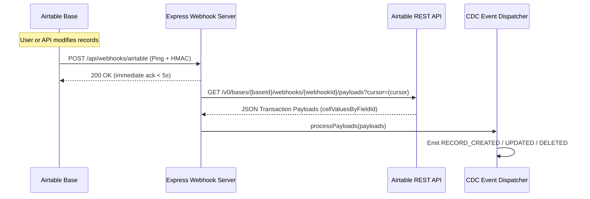

# 📡 Airtable Enterprise Webhooks & CDC Guide

Airtable Webhooks provide near real-time Change Data Capture (CDC) events for enterprise integrations.

---

## 1. Webhook Lifecycle



---

## 2. HMAC-SHA256 Signature Verification
When registering a webhook, Airtable provides a `macSecretConfirmation`.
On every incoming ping, the HTTP header `X-Airtable-Content-MAC` contains the HMAC hex digest:

```typescript
const signature = req.headers['x-airtable-content-mac'];
const expected = crypto.createHmac('sha256', secret).update(rawBody).digest('hex');
const isValid = crypto.timingSafeEqual(Buffer.from(signature), Buffer.from(expected));
```

---

## 3. 7-Day Expiration & Auto-Refresh Heartbeat
Airtable webhooks automatically expire after **7 days** if not renewed.
To keep webhooks alive indefinitely in production:
```bash
# Call the refresh endpoint via CLI
npm run cli -- webhook refresh -b appXXXXXXXX -w achXXXXXXXX
```
Or run a scheduled cron job every 3 days.
