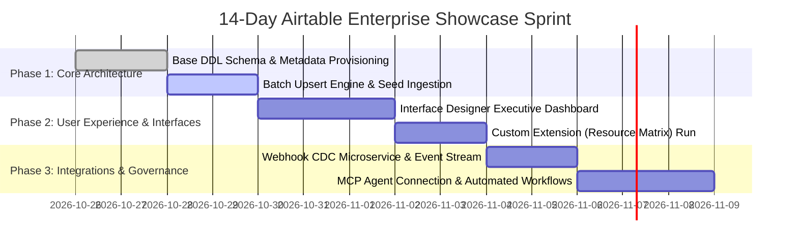

# 🚀 Airtable Enterprise 14-Day Trial Blueprint

> **Target Workspace:** [`https://airtable.com/workspaces/wsp3p16CPCotJVZdX`](https://airtable.com/workspaces/wsp3p16CPCotJVZdX)  
> **Workspace ID:** `wsp3p16CPCotJVZdX`

This blueprint details how to maximize the value of Airtable's 14-Day Full Enterprise Trial on your workspace, unlocking features not available on free or team tiers.

---

## 💎 Enterprise Tier Capabilities Unlocked

| Feature | Enterprise Trial Quota | Standard / Free Tier |
| :--- | :--- | :--- |
| **Record Capacity per Base** | **50,000 to 500,000 records** | 1,000 records |
| **Attachment Storage per Base** | **20 GB to 1,000 GB** | 1 GB |
| **Revision & Snapshot History** | **3 Years** | 2 Weeks |
| **Airtable Interface Designer** | **Full Interactive Access + Role Permissions** | Restricted read-only |
| **Airtable Custom Extensions** | **Unlimited custom block installs** | 1 per base |
| **Airtable Metadata & Webhook API** | **Full Enterprise CDC & DDL access** | Standard REST only |
| **Two-Way Cross-Base Sync** | **Real-time bidirectional sync** | One-way sync |
| **Single Sign-On (SSO) & Audit Logs** | **Enterprise Security & Admin Panel** | None |

---

## 🛠 Recommended 14-Day Implementation Roadmap



---

## 🎨 Enterprise Interface Designer Layouts to Build

During this trial, build 3 interfaces in workspace `wsp3p16CPCotJVZdX`:

### 1. Executive Portfolio Command Center
- **Audience:** C-Suite & Steering Committee
- **Components:**
  - KPI Hero Numbers: Total Capex / Opex Spent, Active Workstreams, Blended Utilization %
  - Interactive Filter: Switch between Project Portfolios (AI, Data, Ops, Security)
  - Gantt Timeline Chart: Project milestones with critical path highlighting

### 2. Resource & Sprint Capacity Planner
- **Audience:** Engineering Leads & Resource Managers
- **Components:**
  - Custom Extension: `Enterprise Capacity & Resource Matrix`
  - Record List: Active team members grouped by Department
  - Detail Drawer: Workload breakdown, allocated tasks, and hourly rate calculations

### 3. Change & Risk Governance Board
- **Audience:** PMO & Compliance Officers
- **Components:**
  - Kanban Board grouped by Risk Severity (Critical, Major, Moderate, Minor)
  - Action Button: Trigger AI Risk Mitigation Enrichment script
  - Audit Trail grid with live CDC timestamps

---

## 🔗 Step-by-Step Workspace Setup

1. **Create Base:**
   Go to [https://airtable.com/workspaces/wsp3p16CPCotJVZdX](https://airtable.com/workspaces/wsp3p16CPCotJVZdX) and click **"Create base"**. Name it **Enterprise Operations Hub**.
2. **Generate Token:**
   Visit [https://airtable.com/create/tokens](https://airtable.com/create/tokens) and create a Personal Access Token (PAT) with full scopes (`data.records:read/write`, `schema.bases:read/write`, `webhook:manage`, `block:manage`).
3. **Execute Seed Command:**
   ```bash
   cp .env.example .env
   # Add your AIRTABLE_API_KEY and AIRTABLE_BASE_ID (from your base URL)
   npm run seed
   ```
4. **Deploy Custom Extension:**
   ```bash
   cd extensions/enterprise-resource-matrix
   block run
   ```
   Paste the generated development URL into your Airtable Base -> Extensions -> Add an extension -> Build a custom extension!
