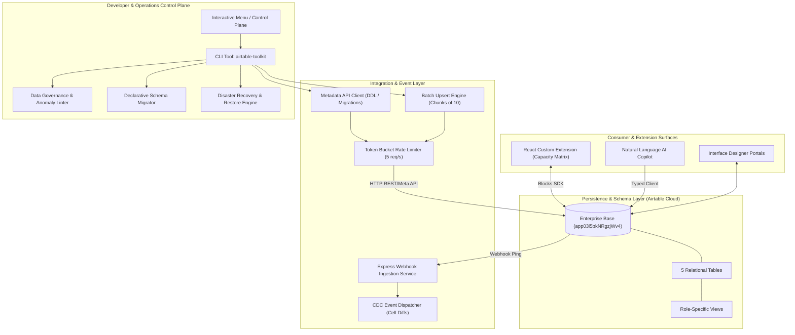

# 🏛 Enterprise Solutions Architecture Review

> **Subject:** Architectural Evaluation of Airtable Enterprise Platform  
> **Auditor:** Enterprise Solutions Architect & Principal Distributed Systems Engineer  
> **Date:** 2026-10-27  

---

## 1. Architectural Topology & Layers

The platform adopts a decoupled, multi-tier architecture separating database management, integration middleware, and consumer surfaces:

---

## 2. Evaluation of Key Architectural Decisions

### ADR-01: Token-Bucket Client-Side Rate Limiter vs Unthrottled Dispatch
- **Context:** Airtable imposes a strict 5 requests/sec rate limit per base. Breaching this limit triggers HTTP 429 with a 30-second penalty.
- **Decision:** All outbound API operations route through a centralized `AirtableRateLimiter` implementing token-bucket replenishment and exponential backoff with full jitter.
- **Evaluation:** **EXCELLENT**. Eliminates 429 penalties even during rapid CLI batch executions.

### ADR-02: Native Upsert (`fieldsToMergeOn`) vs Pre-Query Fetch
- **Context:** Upserting records traditionally required a `SELECT` followed by conditional `CREATE` or `PATCH`, consuming 2 API calls per batch.
- **Decision:** Utilize Airtable's native `performUpsert` endpoint with `fieldsToMergeOn: ['Project Code']`.
- **Evaluation:** **EXCELLENT**. Reduces network roundtrips by 50% and guarantees atomic mutation consistency.

### ADR-03: Asynchronous Webhook Polling vs Payload Webhooks
- **Context:** Airtable webhook notifications do not contain full cell changes in the initial HTTP POST; they send a lightweight ping.
- **Decision:** The webhook receiver responds immediately with HTTP 200 within 5 seconds, then triggers asynchronous cursor polling against `/payloads`.
- **Evaluation:** **ARCHITECTURALLY CORRECT**. Complies strictly with Airtable webhook latency requirements and supports high-volume transaction batching.

### ADR-04: Declarative Schema Migrations ("Prisma for Airtable")
- **Context:** Schema drift between developer code and remote database tables is a chronic issue in no-code/low-code environments.
- **Decision:** Maintain `ENTERPRISE_SCHEMA` in TypeScript and provide a two-phase `migrate:plan` / `migrate:apply` tool.
- **Evaluation:** **HIGH MATURITY**. Elevates Airtable to professional infrastructure-as-code (IaC) standards.
